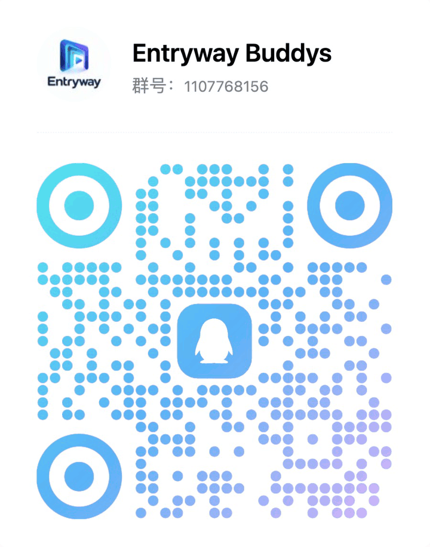

  

<strong>Entryway</strong>

一扇门，通往你的全部影音。把 Emby、Jellyfin、Plex、飞牛影视、极影视、音乐服务器、IPTV 与点播站，连同网盘、NAS 和本地文件，收进同一个客户端。

One entryway to all your media — a client for Emby, Jellyfin, Plex, fnOS, ZSpace, music servers, IPTV and VOD sites, cloud drives, NAS shares and local files.

<a href="https://entryway.top"><strong>官方网站 entryway.top</strong></a> ｜ <a href="https://entryway.top">Official Website</a>

  
  
  
  

---

本仓库是 Entryway 的发布仓库：安装包以 Release 附件形式提供，客户端的更新检测也从这里读取版本。手机、TV、Windows 三端**独立发版**，各自使用 `android-phone-v*`、`android-tv-v*`、`windows-v*` 前缀的 Tag。

## 最新版本 | Latest Releases

| 平台 | 版本 | 构建号 | 系统要求 | 下载（Gitea） | 镜像（GitHub） |
| --- | --- | ---: | --- | --- | --- |
| Android 手机 | **1.0.15** | 75 | Android 8.1+ · arm64 | [entryway-release-1.0.15-arm64-v8a.apk](https://gitea.yamby.cn/yusheng/Entryway_Release/releases/download/android-phone-v1.0.15/entryway-release-1.0.15-arm64-v8a.apk) | [下载](https://github.com/YuSheng-Jack/Entryway_Release/releases/download/android-phone-v1.0.15/entryway-release-1.0.15-arm64-v8a.apk) |
| Android TV（64 位） | **1.0.14** | 58 | Android 6.0+ · arm64 | [Entryway-tv-release-1.0.14-arm64-v8a.apk](https://gitea.yamby.cn/yusheng/Entryway_Release/releases/download/android-tv-v1.0.14/Entryway-tv-release-1.0.14-arm64-v8a.apk) | [下载](https://github.com/YuSheng-Jack/Entryway_Release/releases/download/android-tv-v1.0.14/Entryway-tv-release-1.0.14-arm64-v8a.apk) |
| Android TV（32 位） | **1.0.14** | 58 | Android 6.0+ · armeabi-v7a | [Entryway-tv-release-1.0.14-armeabi-v7a.apk](https://gitea.yamby.cn/yusheng/Entryway_Release/releases/download/android-tv-v1.0.14/Entryway-tv-release-1.0.14-armeabi-v7a.apk) | [下载](https://github.com/YuSheng-Jack/Entryway_Release/releases/download/android-tv-v1.0.14/Entryway-tv-release-1.0.14-armeabi-v7a.apk) |
| Windows x64 | 开发中 | — | Windows 10/11 | 独立版待发布 | — |

| 安装包 | 大小 | SHA-256 |
| --- | ---: | --- |
| `entryway-release-1.0.15-arm64-v8a.apk` | 59,820,620 B | `636c2cdca7d307d4f2eb63d33abcc9a62b7e1cbe3bceb12af7a7778c1d34bb85` |
| `Entryway-tv-release-1.0.14-arm64-v8a.apk` | 56,800,883 B | `54ba05a11c06c14488d8a15be5df4d81ce9827b9a2eb35c3f6a1cc880a4acabd` |
| `Entryway-tv-release-1.0.14-armeabi-v7a.apk` | 50,334,630 B | `0900cab8e0f8dbc6fb2af155246cfdc4fa9eff0d3e8af92c75d040900f1f7abc` |

- 安装包均为 Release 构建，使用正式密钥签名（证书 SHA-256 `a027e7a59bb3931250385e1ba44bd049a9dca9a855101e3263d617b3919b7bcc`）。
- **TV 该下哪个包**：大多数电视、投影仪、盒子用 64 位包；安装时提示「解析错误」「与设备不兼容」的老设备，改用 32 位包。应用内更新会按已装的包自动选择。
- **从 1.0 之前的 Preview 版升级**：签名不同，不能直接覆盖。请先在「设置 › 备份与恢复」备份到本地文件或 WebDAV，卸载旧版、安装新版后再恢复。已装 1.0.1 及以后版本的，在应用内检查更新即可。
- 每个版本的更新内容见对应 Release 说明：[Gitea Releases](https://gitea.yamby.cn/yusheng/Entryway_Release/releases) ｜ [GitHub Releases](https://github.com/YuSheng-Jack/Entryway_Release/releases)。`RELEASE_NOTES.md` 仅保留 v0.24.0 及更早的合并发布记录。

手机版 1.0.15：媒体信息新增实时播放统计、1.75× 倍速、播放器内调整倍速与字幕样式、详情页与追剧日历联动、可隐藏上一集 / 下一集按钮、记忆播放亮度；CMS 点播源先过滤再分页、直播条目不再混入影视行，Jellyfin 官方片头片尾、跨服入库查询失败提示等反馈修复。完整内容见[手机更新说明](https://gitea.yamby.cn/yusheng/Entryway_Release/releases/tag/android-phone-v1.0.15)。

TV 1.0.14：播放中加载在线 / 本地字幕、推荐详情可 MoviePilot 订阅、新增国漫 / 纪录片 / 儿童片片单；同地址多线路互不串用、缓冲按设备预算截断、Jellyfin 官方片头片尾、媒体库排序与首页同步、播放时钟常驻，旧系统可恢复加密备份。完整内容见[TV 更新说明](https://gitea.yamby.cn/yusheng/Entryway_Release/releases/tag/android-tv-v1.0.14)。

手机版 1.0.14：推荐页无需 TMDB 密钥、推荐影片详情按天缓存秒开；新增中英双语字幕与原声音轨偏好、MoviePilot 订阅与追剧日历、继续观看标记已看、进度条缓冲显示、SubDL 字幕；Trakt 同步更准确，跨版本恢复备份，更新改走自有双云下载；修复连接卡住、网速跳动、DVB 字幕、飞牛统计等反馈问题。完整内容见[手机更新说明](https://gitea.yamby.cn/yusheng/Entryway_Release/releases/tag/android-phone-v1.0.14)。

TV 1.0.13：推荐首页改版为独立“服务器”，无需 TMDB 密钥，推荐详情与服务器详情一致、可直接播放、按天缓存秒开；搜索提速，按设备能力优先选择流畅版本，卡顿时可切换到其他服务器的版本，弱 GPU 上杜比视界 P5 帧率提升；媒体库索引栏、手机配置入口合并、跨版本恢复备份，更新改走自有双云下载。完整内容见[TV 更新说明](https://gitea.yamby.cn/yusheng/Entryway_Release/releases/tag/android-tv-v1.0.13)。

手机版 1.0.13：新增杜比视界硬件修正与 P5/P8 系统解码、字幕在线搜索、Hills/AfuseKt/Yamby/CapyPlayer 备份导入导出、多线路自动切换、自定义徽章包与首页组件；修复投屏中断、飞牛续播与分页、弹幕遮挡等大量反馈问题，SMB 播放提速，用户群迁移到 Telegram。完整内容见[手机更新说明](https://gitea.yamby.cn/yusheng/Entryway_Release/releases/tag/android-phone-v1.0.13)。

TV 1.0.12：加入设备三档与资源预算（真机灰度数据仍在收集，可在设置中手动选档）、杜比视界硬件修正与 P5/P8 系统解码、TMDB 聚合推荐首页、多线路自动切换；修复飞牛普通视频无画面、分页、选集与字号缩放等问题，SMB 播放提速。完整内容见[TV 更新说明](https://gitea.yamby.cn/yusheng/Entryway_Release/releases/tag/android-tv-v1.0.12)。

手机版 1.0.12：修复 1.0.11 反复访问 Android Keystore 导致的卡顿，减少重复 TLS 校验和徽标计算；保持磁盘凭据加密，建议覆盖升级。TV 保持 1.0.10。

手机版 1.0.11（已撤下公开下载，请使用 1.0.12）：修复 mpv 续播点与账本内核标记、音乐倍速计时；增强一键诊断、账号/备份保护、Trakt 与播放体验。TV 保持 1.0.10，真实 NAS 与特定片源兼容性仍待验证。Entryway 永久免费。

1.0.10：新增 Mine 影音与音乐账本、年度报告与票根；完善 FN Connect 动态连接、服务器编辑与跨端配置；手机版加入自定义组件与合集封面，TV 改善字号、Hero、网格、媒体库排序和壁纸。两端新增动态开屏和片尾式致谢。完整内容见[手机更新说明](https://gitea.yamby.cn/yusheng/Entryway_Release/releases/tag/android-phone-v1.0.10)与 [TV 更新说明](https://gitea.yamby.cn/yusheng/Entryway_Release/releases/tag/android-tv-v1.0.10)。

## 交流群 | Community

欢迎加入 QQ 用户群 **Entryway Buddys**（群号 **1107768156**）：反馈问题、交流服务器与播放设置，新版本的消息也会第一时间在群里发布。

Join the **Entryway Buddys** QQ group (number **1107768156**) for feedback, tips and release news.

  

> 用 QQ「扫一扫」扫码，或在 QQ 里搜索群号加入。官网 [entryway.top](https://entryway.top/#community) 上也有同一张二维码；手机版、TV 版的「设置 › 关于 › QQ 交流群」里也能找到。

## 支持的媒体源 | Sources

| 类型 | 支持 |
| --- | --- |
| 视频服务器 | Emby 及兼容服务端、Jellyfin、Plex、飞牛影视（fnOS）、极影视 |
| 音乐服务器 | Navidrome、Subsonic 兼容服务、极音乐、飞牛音乐 |
| 直播与点播 | IPTV（M3U / TXT 频道表，XMLTV 节目单）、点播 CMS（苹果 CMS v10 接口、TVBox 配置） |
| 文件源 | 本地文件夹、SMB、WebDAV / Alist、U 盘（TV） |
| 网盘 | 夸克、115、天翼云盘、中国移动云盘、联通云盘、光鸭云盘、CloudDrive2 |
| 弹幕 | 弹弹Play 官方、LogVar 弹幕 API 及其他弹弹Play 兼容服务 |

## 能做什么 | Highlights

### 手机版 1.0.10

- **Mine 与音乐账本**：实际观看/收听时长、热力图、历史筛选、年度报告、影音与黑胶票根；音乐按实际播放输出计时。
- **FN Connect**：保存 FN ID 原入口，动态解析 NAS 地址并校验身份，支持影视与音乐；完善编辑和备份恢复。
- **自定义组件与合集**：支持授权的 Streama 组件导入、参数设置与内容解析，合集海报可自动拼贴。
- **致谢**：动态 Logo 开屏、随机致谢与关于页片尾式滚动名单。

- **跨服务器聚合**：同一部影片在所有服务器上的版本合并展示，按 4K / Dolby Vision / HDR / 1080p 筛选，播放中可切到另一台服务器的同一部片；全服务器合并搜索。
- **推荐 · 接续 · 追剧日历**：组件化推荐页与精选合集（TMDB / 豆瓣榜单），编辑页面时拖动卡片排序；继续观看、播放书签、收藏汇总所有服务器；追剧日历可选 Bangumi、TMDB、Trakt、TVmaze 作数据来源，观看记录可同步到 Trakt。
- **网盘与本地影视库**：网盘支持扫码或手填登录，可浏览、播放、上传；把网盘或 NAS 文件夹加入影视库，读取 NFO 与海报生成海报墙，没有 NFO 的片子可到 TMDB 刮削；网盘与 NAS 上的 DVD / 蓝光 ISO 可从光盘菜单播放（1.0.8 新增），也可直接播放正片。
- **播放器**：ExoPlayer / mpv 双内核，杜比视界与 HDR，跳过片头片尾、章节、画中画、Anime4K、播放书签；IPTV 直播即点即播，播放时可看节目单，频道表和节目单可自动更新（1.0.8 新增）；竖屏短剧自动竖着全屏播放；音画同步与字幕延迟、链接失效自动续上、音轨字幕和弹幕按季记住；HDR 片源的 PGS 图形字幕按 HDR 绘制、亮度可调；性能较弱的手机和平板可打开「性能较弱设备优化」，杜比视界改走硬解 + GPU 色彩修正；界面、字幕、弹幕可分别换成导入的字体，字幕样式两个内核一起调（1.0.8 新增）。
- **AI 字幕**：用你自己的大模型服务翻译字幕，没有字幕时语音识别生成字幕。
- **网络代理**：HTTP / HTTPS 或 SOCKS5，可只代理外网服务和勾选的服务器，局域网默认直连并可单独调整，当前服务器测试显示实际连接路径。
- **STRM 直链播放**：开着时网盘 .strm 片源直接播放链接本身，由网盘 302 到直链，不经服务器转码。
- **点播合集**：TVBox 配置「全部添加」后合成一张卡片，每个站点是一个媒体库，一次搜遍所有站点；资源页可批量删除服务器，一键选中连不上的；可隐藏服务器里的媒体库，轮播和搜索推荐也不再出现（1.0.8 新增）。
- **音乐**：专辑、艺人、歌单，迷你播放器与离线下载。
- **更多**：弹幕、下载、Google Cast 与 DLNA 投屏、本地 / WebDAV 备份恢复（可勾选内容）、关于页的更新日志与 QQ 交流群、四种视觉效果、16 款 APP 图标、六种界面语言。

### Android TV 1.0.10

- **可信账本与票根**：接入观看/音乐记录、年度统计与票根，音乐使用现有 Exo 服务计时。
- **浏览与个性化**：内容字号 100%–300%，更大 Hero，媒体库网格 8–12 列；分别管理导航和首页媒体库显隐/排序，支持 Hero、上传图片或影片壁纸。
- **配置与连接**：FN Connect 动态连接，手机导入媒体服务器并展示具体失败原因，TV 配置中心管理媒体服务器和弹幕接口。
- **致谢与字幕**：动态开屏与片尾式致谢，接入共享 AI 字幕翻译/识别会话。

- 首页自动轮播大图，收藏与媒体库行展示 10–15 张自适应海报，最近播放展示 8–15 张；详情页从续播按钮向下进入单集，左右选择其他集。
- 多服务器“我的”汇总继续观看与收藏；搜索逐台显示结果并保留搜索范围，全应用屏保显示时钟；扫码编辑带入电视上的当前草稿。
- 极影视风格的首页与详情页，毛玻璃设置抽屉；音乐服务器有单独的浏览与播放页面。
- 网盘、CloudDrive2、本地影视库、IPTV 直播（带节目单面板，频道表可自动更新）与点播与手机版一致；DVD / 蓝光 ISO 可从光盘菜单播放（1.0.8 新增）；U 盘、SMB、WebDAV 文件直接播放。
- 搜索支持首字母、全拼和英文，可用电视自带输入法与语音输入，也可以手机扫码输入片名。
- 服务器按影视、音乐、文件源分组，可调整顺序、批量删除、隐藏服务器和媒体库（1.0.8 新增）；TVBox 配置「全部添加」后合成一个点播合集；首次打开即可扫码从手机恢复备份。
- **儿童时长控制**：密码保护，每次打开先答题，答错只能看设定的时长，时间到暂停，仍答错就关闭应用。
- **播放页**：遥控器单击 ← / → 跳设定的秒数、按住连续拖动，快进后自动接着播放，播放中可改快进快退秒数；左上角显示片名艺术字；按住 ↑ 键才切到下一集；字幕、音轨面板把轨道排在最上面；弹幕更平稳；不支持多声道的设备自动降混为立体声。
- **播放**：音画同步与字幕延迟、帧率匹配、确认键长按 3 倍速、链接失效自动续上、放不出来时的诊断面板；音轨字幕和弹幕按季记住，多版本按偏好选择，认片头片尾章节。
- **服务器多线路与测速、Trakt、DLNA 投屏接收、网络代理、STRM 直链播放**；桌面图标改为 16:9 横幅。
- Dolby Vision Profile 5 自绘路径（硬件解码 + GPU 色彩重整形）；提供 64 位与 32 位安装包。

### Windows

- 独立的 Windows 客户端正在开发中，发布后会出现在本仓库的 `windows-v*` Release 里。

## 更新检测 | Update Check

客户端请求本仓库的 Release 列表，按本平台 Tag 前缀与安装包文件名筛选（TV 再按已装的 64 位 / 32 位包选择），优先使用 Gitea，失败时降级到 GitHub。

## 使用说明 | Terms

Entryway 免费下载使用，版权归 Entryway 所有。

Entryway is free to download and use. All rights reserved.
